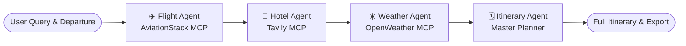

# ✈️ AI Multi-Agent Travel Booking & Planning System (MCP + LangGraph)

An autonomous, multi-agent AI travel booking and itinerary architecture built with **LangGraph**, **Model Context Protocol (MCP)**, **Groq LLaMA 3.3 / GPT-OSS**, and **Streamlit**.

---

## 🌟 Key Features

- **🛫 Departure Origin Selection**: Instant 1-click departure buttons for major global hubs (Delhi, Mumbai, Bengaluru, Chennai, New York, London) plus custom airport input.
- **🤖 Autonomous Multi-Agent Swarm**:
  1. **✈️ Flight Agent (AviationStack MCP)**: Live airport and airline intelligence, routing, airfare ranges, and peak season pricing warnings.
  2. **🏨 Hotel Agent (Tavily Search MCP)**: Discovers and curates top boutique and budget-friendly accommodations with localized pricing.
  3. **☀️ Weather Agent (OpenWeather MCP)**: Atmospheric conditions, multi-day forecasting, and weather-grounded packing guidance.
  4. **🗓️ Master Itinerary Agent**: Crafts complete multi-day itineraries (Day 1 through Day N) with Morning, Afternoon, Evening, Stay locations, and itemized budget breakdowns.
- **🎨 Sleek Dark Glassmorphic UI**: Inspired by modern travel apps with hero image banners, destination strips, quick-fill pills, live streaming progress widgets, and tabbed results.
- **💾 Local Export & Memory**: Automatically saves travel plans to Markdown and supports persistent conversation checkpointing with PostgreSQL or in-memory fallback.

---

## 🏗️ Architecture



---

## 🚀 Quick Start

### 1. Clone the Repository
```bash
git clone https://github.com/sandeep-hacks/final-mcp-with-travel-agent.git
cd final-mcp-with-travel-agent
```

### 2. Configure Environment Variables
Copy `.env.example` to `.env` and fill in your API keys:
```bash
cp .env.example .env
```

| Key | Description | Link |
|---|---|---|
| `GROQ_API_KEY` | Groq LLaMA 3.3 / GPT-OSS acceleration | [Groq Console](https://console.groq.com) |
| `TAVILY_API_KEY` | Real-time web search for hotels & attractions | [Tavily AI](https://tavily.com) |
| `OPENWEATHER_API_KEY` | Current weather and 5-day forecasts | [OpenWeatherMap](https://openweathermap.org/api) |
| `AVIATIONSTACK_API_KEY` | AviationStack flight & airline data | [AviationStack](https://aviationstack.com) |

### 3. Run the Application
Use the provided `run.sh` launcher script, which automatically prepares dependencies and starts Streamlit:
```bash
chmod +x run.sh
./run.sh
```

Or run manually:
```bash
python -m venv langgraph_env3
source langgraph_env3/bin/activate
pip install -r requirements.txt # or uv sync
streamlit run frontend.py
```

The application will be accessible at `http://localhost:8501`.

---

## 🛠️ Tech Stack

- **Orchestration**: [LangGraph](https://github.com/langchain-ai/langgraph)
- **Protocol**: [Model Context Protocol (MCP)](https://modelcontextprotocol.io/)
- **LLM Engine**: Groq (`llama-3.3-70b-versatile`, `openai/gpt-oss-120b`)
- **Frontend**: [Streamlit](https://streamlit.io/) with custom vanilla CSS
- **MCP Servers**:
  - `tavily` (HTTP streamable)
  - `custom_weather_mcp` (Stdio Python MCP)
  - `aviationstack-mcp` (Stdio Python MCP)

---

## 📄 License
MIT License. Created by [Sandeep Kumar](https://github.com/sandeep-hacks).
